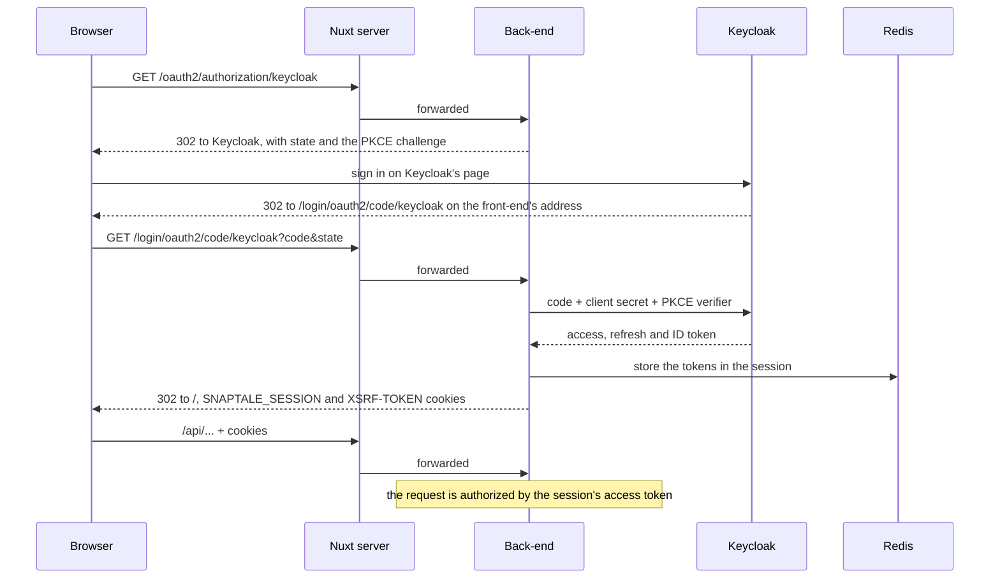

# Authentication

The application never handles a credential. Keycloak (realm `snaptale`) owns every page that touches one: sign-up,
sign-in, email verification, password reset, two-factor authentication and acceptance of the terms of use. The
back-end is a BFF: it signs the user in, keeps the tokens in its session and gives the browser only a session cookie.

## Signing in

1. The front-end sends the browser to `/oauth2/authorization/keycloak`, which the Nuxt server forwards to the back-end.
   `LocalizedAuthorizationRequestResolver` builds the authorization request with PKCE and passes the language from
   the `lang` cookie.
2. Keycloak returns to `/login/oauth2/code/keycloak` on the front-end's address. Spring Security exchanges the code,
   using the confidential client `snaptale-backend` and its secret, and keeps the tokens in the HTTP session.
3. `KeycloakUserService` links the Keycloak identity to a SnapTale account, creating it at the first sign-in, and the
   browser lands on `/`. A sign-in without an email address is refused and lands on `/?login=failed`.

The browser holds only the `SNAPTALE_SESSION` cookie (`HttpOnly`, `SameSite=Lax`, `Secure` in production) and the
`XSRF-TOKEN` cookie.

## Account actions

The account menu changes the password and turns the second factor on and off on Keycloak's own pages, so no password
and no TOTP secret passes through SnapTale. `GET /api/me/second-factor` reads the caller's OTP credential from
Keycloak's account API (`/realms/snaptale/account/credentials`) with the caller's own access token, which carries the
`account` audience and the `manage-account` role every account gets, so SnapTale needs no right to read anyone else's
credentials. The menu then sends the signed-in browser to `/oauth2/authorization/keycloak?kc_action=…`, and
`LocalizedAuthorizationRequestResolver` passes `kc_action` on to Keycloak when it is `UPDATE_PASSWORD`,
`CONFIGURE_TOTP` or `delete_credential:<id>` with a UUID, and drops any other value. Keycloak shows only that page,
asks to confirm a removal and removes a credential only when it is the person's own, then returns through the usual
sign-in to `/`.

## Every API request is authorized by a token

For a request to `/api/*` with a session, `SessionAccessTokenFilter` takes the access token from the session,
refreshing it when it is about to expire, and authorizes the request with that token rather than with the session. The
token is verified like any resource server's: the signature against Keycloak's published keys, the issuer, the expiry
and the audience (`snaptale-api`). The request's identity comes from the token, not from the session.

A client without a browser calls the same API with `Authorization: Bearer` and its own Keycloak token: the same checks
apply, and `BearerTokenAccounts` links its account exactly as a sign-in does.

## Sessions and refreshing

The session lives in Redis for ten hours, and its access token is refreshed once per refresh token, across instances:
[Token refresh](../backend/docs/mechanisms/token-refresh.md).

## Signing out

The front-end posts to `/api/auth/logout`. The back-end ends its session and answers with Keycloak's end-session
address, carrying the ID token; the browser follows it, Keycloak ends its session and returns to the front-end.

## CSRF

Every unsafe request repeats the `XSRF-TOKEN` cookie in a header: [CSRF](mechanisms/csrf.md).

## The sign-in pages

Keycloak draws the sign-in, sign-up, password reset and second-factor pages, and the mails it sends, with the theme in
[`keycloak/themes/snaptale`](../keycloak/themes/snaptale), so they look like the front-end, with its logo:

| Part                      | Holds                                                                                              |
|---------------------------|----------------------------------------------------------------------------------------------------|
| `login/theme.properties`  | extends `keycloak.v2`, whose templates draw every page, and names the legal pages                  |
| `login/template.ftl`      | the page frame: a top bar with the name and the menus, a footer with the legal pages               |
| `login/resources`         | `css/app.css`, the colors, type and card on PatternFly; `js/language.js`, the language handed back |
| `login/messages`          | the texts of the bar and the footer, in Polish and English                                         |
| `email/html/template.ftl` | the frame of every mail; its texts stay Keycloak's own                                             |

The pages are light only, as the app is: `darkMode=false` in `theme.properties` turns off Keycloak's dark mode, and the
theme menu with it.

The language goes both ways. The sign-in page opens in the application's language, sent as `ui_locales`; Keycloak shows
a signed-in person their account's language instead, so the application stores a signed-in person's choice there at
once, through `PUT /api/me/language`, and again before an account action. The language the reader last chose, in the
application or in Keycloak's own menu, is kept in the cookie `ui_locale_snaptale`, which both write, under the domain
Keycloak shares with the application, the parent of Keycloak's host (on localhost, every port), and for a year: the
front-end, which also keeps the `lang` cookie the back-end reads in step with it, reads it whenever a page loads and
writes it when the reader picks a language, and `language.js` writes it on a choice in Keycloak's menu. Being a shared
record rather than a message, it keeps the two in step however the reader moves between them.

`template.ftl` is a copy of `keycloak.v2`'s own, changed only where it says `Changed from keycloak.v2`. Keycloak builds
its pages from that template, so after an upgrade of Keycloak the copy is compared with the new release's and brought up
to date. The Keycloak theme workflow does the comparison: `keycloak/check-template.sh` fails when the template in the
Keycloak image of `docker-compose.local.yml` is not the one the copy was made from, recorded as `parentTemplateSha256`
in `theme.properties`, which changes with the copy. The colors are those of `frontend/app/assets/css/main.css` and the
Tailwind grays the front-end draws with. A mail's colors are written as hex, since mail clients read neither `oklch()`
nor `light-dark()`. The links of the bar and the footer lead to the client's base URL, `baseUrl` in the realm.

The realm names the theme in `loginTheme` and `emailTheme`. Locally, compose mounts the folder into Keycloak. A Keycloak
that serves several applications, each in its own realm, takes it as a JAR in `/opt/keycloak/providers`:
`keycloak/build-theme.sh` writes `keycloak/target/snaptale-keycloak-theme.jar`, and `keycloak/Dockerfile` builds an
image holding it in `/themes`, which the Keycloak theme workflow publishes on a `keycloak-theme-v*` tag.

## Code

| Class                                                                   | Role                                                 |
|-------------------------------------------------------------------------|------------------------------------------------------|
| `security/SecurityConfig`                                               | the filter chain, the client registration, CSRF      |
| `security/LocalizedAuthorizationRequestResolver`                        | PKCE and the language                                |
| `auth/KeycloakUserService`, `auth/BearerTokenAccounts`                  | linking the account at sign-in and for bearer tokens |
| `security/SessionAccessTokenFilter`, `security/SessionAccessTokens`     | a session's request authorized by its token          |
| `security/SingleFlightRefreshTokenProvider`, `security/SharedRefreshes` | one refresh per refresh token                        |
| `security/LogoutUrlResponder`                                           | Keycloak's end-session address                       |
| `user/UserAccounts`                                                     | the SnapTale account linked to a Keycloak identity   |
| `keycloak/KeycloakAccounts`                                             | the way into Keycloak's account: actions, language   |
| `frontend/app/composables/keycloak`                                     | the shared language and the account actions          |
